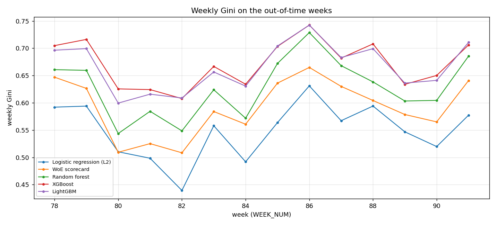
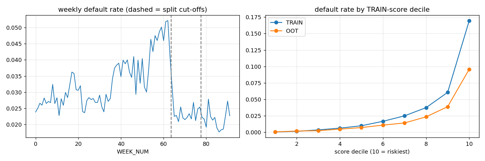
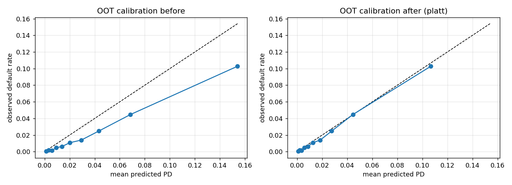
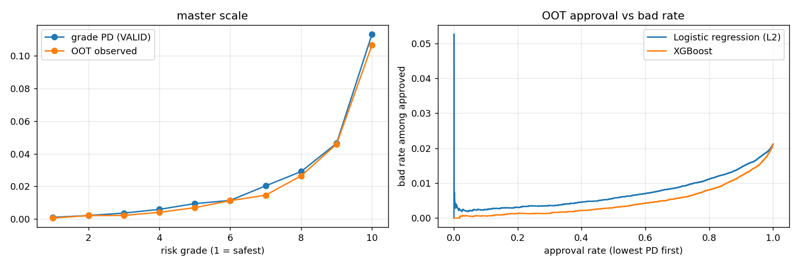
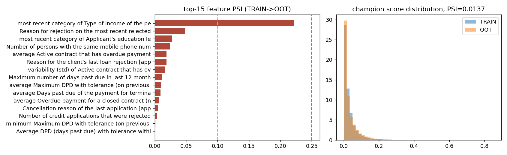

# Credit Risk Modelling | Loan Default Prediction with Out-of-Time Validation

This project predicts loan default on the Kaggle competition data *Home Credit - Credit Risk Model Stability* (1,526,659 applications, overall default rate 3.14%). The split is by calendar week. Models are fitted on 2019-01-01 to 2020-03-23 (weeks 0-63, 1,282,082 applications), tuned on 2020-03-24 to 2020-06-29 (weeks 64-77, 92,870) and scored once on 2020-06-30 to 2020-10-05 (weeks 78-91, 151,707 applications, default rate 2.12%). Seven models share one feature set and one split: a base-rate dummy, L2 logistic regression, a WoE scorecard, random forest, XGBoost, monotone XGBoost and LightGBM. The selection rule was frozen on VALID before OOT was scored and picked **XGBoost**. On OOT it reaches AUC 0.839, Gini 0.679 and KS 0.533, against Gini 0.557 for logistic regression (paired-bootstrap difference +0.122, 95% interval +0.110 to +0.133). The model uses 177 features built from 7 of the 16 source tables.

The data are used under the competition rules and are not in this repository. Results are specific to this split and to one run, and they are not comparable with the Kaggle leaderboard (see the limitations). This document describes version 5 of the pipeline. Versions 1 to 4 contained defects that are described in the run history.

## 1. Results

Source: `artifacts/metrics_table.csv`. OOT is weeks 78-91. VALID is weeks 64-77 and also drives early stopping, tuning, calibrator and cut-offs, so VALID figures are optimistic for the tuned models.

| Model | OOT AUC | VALID AUC | OOT Gini | VALID Gini | OOT KS | VALID KS | OOT PR-AUC | VALID PR-AUC |
|---|---|---|---|---|---|---|---|---|
| Logistic regression (L2) | 0.778 | 0.763 | 0.557 | 0.525 | 0.423 | 0.397 | 0.084 | 0.087 |
| WoE scorecard | 0.801 | 0.790 | 0.601 | 0.581 | 0.465 | 0.441 | 0.093 | 0.101 |
| Random forest | 0.820 | 0.803 | 0.640 | 0.605 | 0.492 | 0.458 | 0.111 | 0.116 |
| XGBoost | 0.839 | 0.822 | 0.679 | 0.645 | 0.533 | 0.496 | 0.133 | 0.134 |
| XGBoost (monotone) | 0.835 | 0.818 | 0.670 | 0.636 | 0.520 | 0.490 | 0.126 | 0.128 |
| LightGBM | 0.837 | 0.821 | 0.675 | 0.642 | 0.526 | 0.494 | 0.131 | 0.136 |
| Dummy (base rate) | 0.500 | 0.500 | 0.000 | 0.000 | 0.036 | 0.045 | 0.021 | 0.024 |

The OOT base rate is 2.12%, which is the PR-AUC of a random ranking. The dummy KS is not zero because tied scores are split by row order.

Paired bootstrap of the OOT Gini difference with 1000 resamples of applications (`artifacts/bootstrap_ci.json`). The resampling ignores week-level dependence and refit variability.

| XGBoost minus | Gini difference | 95% lower | 95% upper | Share of resamples above 0 |
|---|---|---|---|---|
| logistic regression | 0.122 | 0.110 | 0.133 | 1.000 |
| WoE scorecard | 0.077 | 0.069 | 0.086 | 1.000 |
| random forest | 0.039 | 0.032 | 0.046 | 1.000 |
| LightGBM | 0.004 | 0.001 | 0.007 | 0.992 |



## 2. Data and point-in-time design

* Source: Kaggle competition [home-credit-credit-risk-model-stability](https://www.kaggle.com/competitions/home-credit-credit-risk-model-stability), labelled train files only. The competition page restricts the data to competition use, so `data/raw/` is git-ignored. Size and sha256 of each of the 32 train parquet files are in `artifacts/data_provenance.json`, and the sha256 of 44 output files is in `artifacts/MANIFEST.json`.
* Unit: one row per credit application (`case_id`). Prediction time: `date_decision`. Target: the competition `target`, a default flag observed after the decision.
* Point-in-time rule (`pit_filter` in `src/hc_data.py`): a history record is dropped if its latest date, or its latest (year, month) pair, is after `date_decision`. Records with no usable date are kept. Drop counts per table are in `artifacts/pit_audit.json`.

**Tables.** `TABLE_SPECS` in `src/hc_config.py` lists 16 logical tables. Each logical table is the union of all its numbered part files (`table_parts` and `scan_table` in `src/hc_data.py`). Schemas are aligned across parts, missing columns become null and dtypes are relaxed to a common type. Depth 1 and 2 tables are aggregated part by part and the results are stacked. This is exact because each `case_id` lives in exactly one part, and the loader raises if that ever fails.

| Logical table | Depth | Part files | Rows in | Dropped by PIT rule | Applications with data | Final features |
|---|---|---|---|---|---|---|
| train_static_0 | 0 | 2 | 1,526,659 | 20.8% | 1,208,906 | 76 |
| train_static_cb_0 | 0 | 1 | 1,500,476 | 98.3% | 25,263 | 0 |
| train_person_1 | 1 | 1 | 2,973,991 | 0.0% | 1,526,659 | 5 |
| train_applprev_1 | 1 | 2 | 6,525,979 | 8.9% | 1,171,847 | 51 |
| train_credit_bureau_a_1 | 1 | 4 | 15,940,537 | 42.4% | 1,386,248 | 22 |
| train_credit_bureau_b_1 | 1 | 1 | 85,791 | 94.3% | 4,661 | 0 |
| train_debitcard_1 | 1 | 1 | 157,302 | 0.0% | 111,772 | 0 |
| train_deposit_1 | 1 | 1 | 145,086 | 0.4% | 104,689 | 0 |
| train_other_1 | 1 | 1 | - | - | 51,109 | 0 |
| train_tax_registry_b_1 | 1 | 1 | 1,107,933 | 7.3% | 150,199 | 0 |
| train_tax_registry_c_1 | 1 | 1 | 3,343,800 | 21.7% | 403,018 | 0 |
| train_applprev_2 | 2 | 1 | - | - | 1,221,522 | 3 |
| train_person_2 | 2 | 1 | 1,643,410 | 0.0% | 1,435,105 | 0 |
| train_credit_bureau_a_2 | 2 | 11 | 188,298,452 | 10.2% | 1,385,120 | 14 |
| train_credit_bureau_b_2 | 2 | 1 | 1,286,755 | 0.6% | 36,419 | 6 |

Source: `artifacts/pit_audit.json`, `artifacts/feature_meta.json`. `train_tax_registry_a_1 (no usable columns)` was read but gave no usable column. `Rows in` is empty for tables without a date column, where the rule does not apply.

**Relative dates.** Absolute calendar values identify when an application happened and separate training from later weeks by construction. Date columns (suffix `D`) therefore enter only as days before `date_decision`, and the year and month column pairs (`pmts_year_*`, `pmts_month_*`) only as months before the decision month (`relative_expr` in `src/hc_data.py`). These are aggregated as `rel_mean`, `rel_max`, `rel_min` and `rel_std`. A date column is never used as a categorical, and the index columns `num_group*` are not candidates. Quality gate `no_absolute_calendar_features` fails the run if a final feature is built from a calendar column without this transform. 37 of the 177 final features are relative-date aggregates.

**Coverage by split.** `scripts/check_table_parts.py` reads only `case_id` from every train file and joins `WEEK_NUM` from `train_base` (`artifacts/table_parts_check.json`). The last column is the mean non-null share of the table's final features among OOT applications (`artifacts/feature_coverage.json`). It cannot exceed the share of applications the table covers.

| Logical table | Weeks | TRAIN apps covered | VALID apps covered | OOT apps covered | Mean non-null share of final features in OOT |
|---|---|---|---|---|---|
| train_static_0 | 0-91 | 100.0% | 100.0% | 100.0% | 64.4% |
| train_static_cb_0 | 0-91 | 98.0% | 100.0% | 99.8% | - |
| train_person_1 | 0-91 | 100.0% | 100.0% | 100.0% | 89.3% |
| train_applprev_1 | 0-91 | 78.9% | 84.6% | 86.3% | 77.9% |
| train_credit_bureau_a_1 | 0-91 | 89.8% | 96.1% | 96.4% | 60.5% |
| train_credit_bureau_b_1 | 0-91 | 2.1% | 3.8% | 3.6% | - |
| train_debitcard_1 | 0-91 | 7.1% | 8.1% | 8.6% | - |
| train_deposit_1 | 0-91 | 6.7% | 7.6% | 8.1% | - |
| train_other_1 | 54-91 | 1.5% | 12.4% | 13.1% | - |
| train_tax_registry_a_1 | 34-91 | 34.6% | 13.4% | 1.1% | - |
| train_tax_registry_b_1 | 62-91 | 0.1% | 54.5% | 65.4% | - |
| train_tax_registry_c_1 | 0-40 | 37.6% | 0.0% | 0.0% | - |
| train_applprev_2 | 0-91 | 78.9% | 84.6% | 86.3% | 86.3% |
| train_person_2 | 0-91 | 97.9% | 87.6% | 65.0% | - |
| train_credit_bureau_a_2 | 0-91 | 89.7% | 96.1% | 96.3% | 90.3% |
| train_credit_bureau_b_2 | 0-91 | 2.1% | 3.8% | 3.6% | 3.6% |

Two tables cover only part of the calendar. `train_tax_registry_c_1` ends in week 40 and `train_tax_registry_b_1` starts in week 62. Neither has enough recent TRAIN rows to pass the coverage rule, so neither contributes features.

**Coverage gate.** `artifacts/feature_coverage.json` stores the non-null share of every model column in TRAIN, VALID and OOT. Candidates need at least 1% non-null values among TRAIN rows of the last 8 TRAIN weeks, which uses no VALID or OOT information. The run fails if a final feature has no value at all in VALID or OOT. Result: 0 of 177 final features are empty in VALID and 0 in OOT.

## 3. Time split

`split_bounds` in `src/hc_data.py` divides the consecutive weeks 70 / 15 / 15 so that every week falls in exactly one partition. Source: `artifacts/split.json`.

| Split | Weeks | Number of weeks | From | To | Applications | Share | Default rate |
|---|---|---|---|---|---|---|---|
| TRAIN | 0-63 | 64 | 2019-01-01 | 2020-03-23 | 1,282,082 | 84.0% | 3.32% |
| VALID | 64-77 | 14 | 2020-03-24 | 2020-06-29 | 92,870 | 6.1% | 2.43% |
| OOT | 78-91 | 14 | 2020-06-30 | 2020-10-05 | 151,707 | 9.9% | 2.12% |

The default rate falls from 3.32% to 2.12%. An exact decomposition on TRAIN-score deciles (`artifacts/default_rate_drop.json`) splits the change of -0.0120 into a score-mix effect of +0.0021 and a within-band rate effect of -0.0141. The drop happens inside the same risk bands and is not explained by safer applicants. The cause was not tested. Payment relief during 2020 is a plausible context but remains an assumption.



## 4. Features and screening

The pipeline builds 492 model columns (25 categorical codes) from 240 screened raw columns. For each depth 1 and 2 table a column needs at least 30% non-null values on a TRAIN sample, and the top 16 numeric and 6 categorical columns are kept by univariate AUC. Aggregates per application are the record count, days since the newest record, mean, max, min and std of each numeric column, and the distinct count and largest category code of each categorical column. Category codes are ranks in the sorted TRAIN levels of the whole logical table, so they are identical across part files.

Selection steps in order, all on TRAIN rows (`feature_screen` in `src/hc_pipeline.py`):

1. Coverage rule: 106 columns removed because their non-null share was below 1% in the last 8 TRAIN weeks.
2. Calendar-proxy screen: every relative-date feature is correlated (Spearman) with `WEEK_NUM` on a TRAIN sample and dropped if the absolute correlation is at least 0.8. 80 features were screened and 2 dropped: `refreshdate_3813885D__rel_max` (rho 0.905), `refreshdate_3813885D__rel_std` (rho 0.892). Gate `no_calendar_proxy_features` checks that no final feature breaches the threshold. Source: `artifacts/calendar_proxy_screen.csv`.
3. Univariate leakage screen: a column whose own AUC exceeds 0.8 is quarantined. Quarantined: 0.
4. Information value on 10 quantile bins: keep IV of at least 0.02. 177 columns pass, and they are the 177 tree features (`artifacts/iv_table.csv`).
5. Linear design: the top 120 numeric columns by IV plus one-hot codes of categoricals with at most 8 TRAIN levels, then removal of columns with absolute correlation of at least 0.95. Imputation and scaling are fitted on TRAIN.
6. Scorecard variables: the top 70 numeric columns by IV, then the steps in section 5.

Final feature count by source table, with the mean non-null share of those features per split (`artifacts/feature_coverage.json`, `by_source`):

| Source table | Final features | TRAIN | VALID | OOT |
|---|---|---|---|---|
| train_applprev_1 | 51 | 68.7% | 75.9% | 77.9% |
| train_applprev_2 | 3 | 78.9% | 84.6% | 86.3% |
| train_credit_bureau_a_1 | 22 | 36.9% | 62.9% | 60.5% |
| train_credit_bureau_a_2 | 14 | 70.1% | 89.6% | 90.3% |
| train_credit_bureau_b_2 | 6 | 2.1% | 3.8% | 3.6% |
| train_person_1 | 5 | 90.1% | 87.0% | 89.3% |
| train_static_0 | 76 | 57.9% | 61.2% | 64.4% |

The leakage gate (section 8) checks structure, ordering, single-feature AUC and fitting scope. It cannot prove that no feature carries post-decision information.

## 5. Models, tuning and the selection rule

All models see the same split and the same screened columns. Hyper-parameter choices use VALID only (`artifacts/tuning.json`).

* **Logistic regression.** L2 penalty, saga solver, C chosen on VALID AUC from 4 values (0.001, 0.01, 0.1, 1.0). Chosen C = 0.1.
* **WoE scorecard.** Monotone optimal binning (optbinning) on a TRAIN sample, IV filter, iterative VIF pruning at 5.0, statsmodels Logit, then wrong-sign variables are dropped one at a time. Sign consistency was 39 of 46 before the fix and 37 of 37 after, with 37 variables. Points use PDO 20 and 600 points at 20:1 odds (`artifacts/scorecard_points.csv`).
* **Random forest.** 200 trees, depth 12, minimum leaf 50, fitted on a 500,000-row TRAIN subsample, so it is handicapped against the boosters.
* **XGBoost.** Random search over 6 configurations on a 500,000-row TRAIN subsample scored on VALID AUC, then refit on all TRAIN rows. Chosen: `{"colsample_bytree": 0.5, "max_depth": 7, "min_child_weight": 100, "reg_lambda": 1.0, "subsample": 0.9}`. Best iteration 797 of at most 800.
* **Monotone XGBoost.** Same parameters, with 132 of 177 features constrained to the sign of their TRAIN Spearman correlation.
* **LightGBM.** Fixed parameters, no search, best iteration 564.
* **Class imbalance** was not handled and not tested. No class weights or resampling were used.

**Selection rule, frozen before OOT.** `max VALID Gini; models within 0.002 Gini of the best are tied and the tie goes to 'xgboost'`. It is applied in the freeze cell of the notebook and written to `artifacts/champion.json` at 2026-11-06T05:41:06 together with the calibrator choice and the cut-offs. OOT is scored in the next cell. The monotone variant and the dummy are not candidates.

| Model | VALID Gini |
|---|---|
| XGBoost | 0.645 |
| LightGBM | 0.642 |
| Random forest | 0.605 |
| WoE scorecard | 0.581 |
| Logistic regression (L2) | 0.525 |

Tied set within 0.002 Gini of the best: ['xgboost']. Selected model: XGBoost.

## 6. Calibration

The calibrator for XGBoost is chosen on VALID alone. Each candidate is fitted on VALID weeks below 71 and scored on the later VALID weeks, and the lowest log loss wins. The winner, **platt**, is then refitted on all VALID rows and applied to OOT. The table is the OOT result (`artifacts/calibration.json`). ECE is the expected calibration error over deciles.

| Calibration | Mean predicted PD | Observed rate | Expected / actual | ECE | Brier | Log loss | Chosen on VALID |
|---|---|---|---|---|---|---|---|
| none (raw) | 0.0349 | 0.0212 | 1.6467 | 0.0137 | 0.0199 | 0.0880 | no |
| platt | 0.0230 | 0.0212 | 1.0875 | 0.0019 | 0.0195 | 0.0845 | yes |
| isotonic | 0.0231 | 0.0212 | 1.0896 | 0.0022 | 0.0195 | 0.0849 | no |

The raw score over-predicts by a factor of 1.65 on OOT, with ECE 0.0137. After platt scaling the factor is 1.09 and ECE is 0.0019. The cause of the raw over-prediction was not traced, and part of it follows from the lower default rate in OOT.



## 7. Credit policy

Cut-offs are computed on VALID raw PD and applied unchanged to OOT. An application is approved when its PD is below the cut-off. All rates are observed OOT outcomes. The data hold no cost of review, margin or exposure for the new loan, so no monetary result is estimated. Source: `artifacts/cutoff_strategies.csv`.

| Strategy | Model | OOT approval rate | Bad rate, approved | Bad rate, declined | Defaulters declined |
|---|---|---|---|---|---|
| approve all | - | 100.00% | 2.12% | - | 0.00% |
| bad rate <= 1.5% (VALID) | Logistic regression (L2) | 85.85% | 1.28% | 7.22% | 48.18% |
| bad rate <= 1.5% (VALID) | XGBoost | 91.76% | 1.30% | 11.20% | 43.58% |
| bad rate <= 1.5% (VALID) | LightGBM | 91.33% | 1.28% | 10.99% | 44.98% |
| bad rate <= 2.0% (VALID) | Logistic regression (L2) | 95.86% | 1.75% | 10.79% | 21.06% |
| bad rate <= 2.0% (VALID) | XGBoost | 97.70% | 1.73% | 18.78% | 20.34% |
| bad rate <= 2.0% (VALID) | LightGBM | 97.63% | 1.71% | 18.80% | 21.00% |
| approval rate 80% (VALID) | Logistic regression (L2) | 81.58% | 1.16% | 6.38% | 55.46% |
| approval rate 80% (VALID) | XGBoost | 80.88% | 0.83% | 7.57% | 68.24% |
| approval rate 80% (VALID) | LightGBM | 80.19% | 0.83% | 7.33% | 68.55% |

The 80% target is the 80% quantile of VALID raw PD, so the OOT approval rate differs: 80.88% for XGBoost, 81.58% for logistic regression and 80.19% for LightGBM. The bad rate of approved loans is 0.83%, 1.16% and 0.83%, against 2.12% when everyone is approved. Because the approval rates differ, the models are also compared at exactly 80% (`business.json`, `swap_sets`). The bad rate of approved loans is then 0.81% for XGBoost and 1.11% for logistic regression, with 121,366 loans approved by each. The 11,121 loans only XGBoost approves have a bad rate of 1.91%, and the 11,121 loans only logistic regression approves have 5.26%.

**Capture of defaulters.** Share of OOT defaulters inside the riskiest 5, 10 and 20% of OOT applications (`artifacts/business.json`, `capture`). The last row is the expected value for a random ordering.

| Model | Top 5% | Top 10% | Top 20% |
|---|---|---|---|
| Logistic regression (L2) | 24.5% | 38.6% | 58.0% |
| WoE scorecard | 26.3% | 41.0% | 61.8% |
| Random forest | 30.1% | 45.7% | 65.8% |
| XGBoost | 33.7% | 48.5% | 69.6% |
| LightGBM | 33.1% | 48.7% | 68.9% |
| random (reference) | 5.0% | 10.0% | 20.0% |

**Risk grades.** Ten equal-count grades from the VALID score of the selected model. The grade PD is the VALID default rate. Each grade gets an exact two-sided binomial test on OOT, uncorrected for multiple testing (`artifacts/master_scale.csv`).

| Grade | OOT apps | Grade PD (VALID) | OOT default rate | Binomial p | OOT vs grade PD |
|---|---|---|---|---|---|
| 1 | 17,521 | 0.0011 | 0.0006 | 0.0821 | lower than PD |
| 2 | 15,491 | 0.0022 | 0.0021 | 1.0000 | lower than PD |
| 3 | 15,273 | 0.0037 | 0.0022 | 0.0020 | lower than PD |
| 4 | 14,984 | 0.0059 | 0.0041 | 0.0034 | lower than PD |
| 5 | 14,914 | 0.0095 | 0.0070 | 0.0011 | lower than PD |
| 6 | 14,707 | 0.0114 | 0.0113 | 0.9381 | lower than PD |
| 7 | 15,045 | 0.0204 | 0.0146 | <0.0001 | lower than PD |
| 8 | 14,773 | 0.0291 | 0.0265 | 0.0594 | lower than PD |
| 9 | 14,776 | 0.0464 | 0.0459 | 0.7843 | lower than PD |
| 10 | 14,223 | 0.1133 | 0.1066 | 0.0115 | lower than PD |

The OOT default rate is monotone across grades: True. The illustrative expected loss uses an assumed LGD of 0.45 (Basel foundation-IRB value for senior unsecured claims) and the application credit amount as exposure, median-filled when missing. It gives an expected total of 101,137,778 against 96,943,646 when the same LGD is applied to observed defaults (ratio 1.043). This is not a measured loss.



## 8. Stability and drift

**Weekly Gini.** The competition stability metric is `mean(weekly Gini) + 88 * min(0, slope) - 0.5 * std(residuals)`, computed over OOT weeks with enough applications (`artifacts/stability.csv`).

| Model | Mean weekly Gini | Slope per week | Residual std | Stability metric |
|---|---|---|---|---|
| Logistic regression (L2) | 0.549 | 0.0020 | 0.0506 | 0.524 |
| WoE scorecard | 0.591 | 0.0030 | 0.0509 | 0.566 |
| Random forest | 0.628 | 0.0036 | 0.0525 | 0.602 |
| XGBoost | 0.672 | 0.0014 | 0.0421 | 0.651 |
| XGBoost (monotone) | 0.661 | 0.0029 | 0.0493 | 0.636 |
| LightGBM | 0.666 | 0.0026 | 0.0432 | 0.644 |

**Score PSI.** TRAIN to VALID 0.011, TRAIN to OOT 0.014 (band `stable`). The TRAIN baseline is the model's in-sample score. Month by month against the VALID score distribution (`artifacts/monitoring.json`): 2020-06 0.006, 2020-07 0.001, 2020-08 0.010, 2020-09 0.003, 2020-10 0.004. Bands: below 0.10 stable, 0.10 to 0.25 watch, above 0.25 alert.

**Feature PSI.** TRAIN to OOT for the 177 model features (`artifacts/psi.csv`): stable 158, alert 10, watch 9.

**Adversarial validation** (`adversarial_validation` in `src/hc_stability.py`). A LightGBM classifier is trained to separate TRAIN from OOT applications on 150,000 sampled rows per side with a 70/30 split. The held-out AUC is **0.999**. The five strongest separating features by gain share (`artifacts/drift.json`):

| Feature | Source | Gain share | In model top 15 by gain |
|---|---|---|---|
| `postype_4733339M__maxcode` | train_applprev_1 | 0.346 | no |
| `pmts_year_1139T__rel_max` | train_credit_bureau_a_2 | 0.201 | no |
| `persontype_1072L__std` | train_person_1 | 0.109 | no |
| `pmts_year_1139T__rel_std` | train_credit_bureau_a_2 | 0.103 | no |
| `pmts_year_507T__rel_max` | train_credit_bureau_a_2 | 0.051 | no |

How to read this. The classifier uses no label, so the figure measures how separable the two periods are and is not target leakage. An AUC near 1 means OOT applications are easy to tell apart from TRAIN. The separating features are aggregates of history tables (category codes, payment timing and person-type summaries), with `postype_4733339M__maxcode` taking the largest share. A likely reason is a change in product mix and in how much history each source holds in later weeks, but this was not tested. 0 of the five are among the model's top 15 features by gain, so the model does not rely on them. The score PSI of 0.014 and the OOT Gini of 0.679 against 0.645 on VALID show no loss of ranking power. The OOT result is still an estimate for a different population. The residual separators were not removed, because dropping features by their adversarial importance would tune the feature set to the OOT period.



**Monitoring plan** (written, not run on a live portfolio). Gini trigger: weekly Gini more than 0.05 below the VALID mean for 2 consecutive weeks. Calibration trigger: mean predicted PD / observed default rate outside [0.8, 1.25] for a month. Data trigger: PSI of any feature in the model above the alert band, or a new category above 5% share. Minimum weekly volume: 150 applications.

**Most important XGBoost features** by gain share (`artifacts/top_features.csv`):

| Feature | Gain share | Non-null share in OOT |
|---|---|---|
| Average DPD (days past due) with tolerance within the past 24 months from the... [application] | 0.0415 | 57.4% |
| average Days past due of the payment for terminated contract according to credit bure... [credit bureau (a)] | 0.0375 | 91.1% |
| average Maximum DPD with tolerance (on previous application/s) [previous applications] | 0.0373 | 75.2% |
| Cancellation reason of the last application [application] | 0.0366 | 79.0% |
| Reason for the client's last loan rejection [application] | 0.0247 | 79.0% |
| Reason for rejection on the most recent rejected application [application] | 0.0187 | 79.0% |
| highest category code of Applicant's education level from their previous application [previous applications] | 0.0183 | 84.2% |
| Maximum number of days past due in last 12 months [application] | 0.0175 | 41.3% |
| average Active contract that has overdue payments (num_group1 - existing contract, nu... [credit bureau (b)] | 0.0168 | 3.6% |
| Number of persons with the same mobile phone number [application] | 0.0158 | 79.0% |

## 9. Quality gates

20 of 20 gates pass (`artifacts/quality_gates.json`). The leakage, coverage, calendar and proxy checks raise before any model is fitted. The remaining gates are evaluated at the end of the run.

| Gate | Status | Detail |
|---|---|---|
| leakage:no_id_or_outcome_columns | PASS | {"exact": [], "token": []} |
| leakage:target_not_in_design | PASS | {"columns_checked": 150} |
| leakage:time_split_ordering | PASS | {"oot_min": "2020-06-30", "train_max": "2020-03-23", "valid_max": "2020-06-29", "valid_min": "2020-03-24"} |
| leakage:no_case_overlap | PASS | {"overlapping_cases": 0} |
| leakage:univariate_auc_screen | PASS | {"quarantined": [], "still_in_design": []} |
| leakage:scaler_fitted_on_train_rows | PASS | {"delta_full": 145.30133756709438, "delta_train": 6.803584437875543e-05, "full_mean": 4042.623779296875, "scaled_mean": 3897.3224417297806, "train_... |
| leakage:woe_binned_on_train_rows | PASS | {"bin_count_sum": 250000.0, "fit_fraction": 0.19499532791194324, "train_rows": 1282082.0, "variable": "train_static_0__avgdpdtolclosure24_3658938P"... |
| leakage:woe_fit_sample_within_train | PASS | {"train_rows": 1282082.0, "woe_fit_rows": 250000.0} |
| dummy_baseline_beaten | PASS | {"lightgbm": true, "penalised_lr": true, "random_forest": true, "woe_scorecard": true, "xgboost": true, "xgboost_monotone": true} |
| plausible_oot_range | PASS | {"champion_oot_auc": 0.8393474485997937, "range": [0.74, 0.86]} |
| valid_oot_gap_under_0.05 | PASS | {"oot_auc": 0.8393474485997937, "valid_auc": 0.8224145892449879} |
| scorecard_all_signs_consistent | PASS | {"before_fix": {"consistent": 39, "total": 46}, "consistent": 37, "total": 37} |
| calibration_expected_actual_after | PASS | {"after": 1.0874590009810916, "before": 1.6466547584411309} |
| score_psi_train_to_oot | PASS | {"psi": 0.013716336444560632} |
| xgb_minus_lr_ci_excludes_zero | PASS | {"ci95_hi": 0.13280111152386886, "ci95_lo": 0.11048425166996871, "n_boot": 1000, "point_gini_diff": 0.12175146477250265, "share_positive": 1.0} |
| coverage_no_final_feature_empty_in_valid_or_oot | PASS | {"n_final_features": 177, "null_in_oot": [], "null_in_valid": []} |
| no_absolute_calendar_features | PASS | {"absolute_calendar_features": [], "n_features_checked": 177, "n_relative_features": 37} |
| no_calendar_proxy_features | PASS | {"n_dropped": 2, "n_screened": 80, "offending_final_features": [], "threshold": 0.8} |
| adversarial_auc_and_top_drivers_reported | PASS | {"auc": 0.9992483281481482, "note": "reported, not gated on its value", "top_drivers": [{"feature": "train_applprev_1__postype_4733339M__maxcode", ... |
| champion_frozen_before_oot | PASS | {"file": "artifacts/champion.json"} |

## 10. Run history

Four earlier runs are kept for comparison. Each row is a full run on the same split. Sources: `artifacts_v1_partsbug/`, `kaggle/pull_v3_gpu/`, `kaggle/pull_v4_gpu/` and `artifacts/`.

| Run | Change | Final features | Empty in OOT | Selected model | Selected OOT Gini | XGBoost OOT Gini | Adversarial AUC | Top adversarial driver (gain share) |
|---|---|---|---|---|---|---|---|---|
| v1 | Table-parts bug: only some part files were read, each part a separate feature block | 243 | 145 (OOT sample) | LightGBM | 0.565 | 0.561 | 0.971 | `lastrejectreason_759M` (0.38) |
| v3 | All part files read and coverage gate added. Dates still used as categorical codes and raw years | 166 | 0 | XGBoost | 0.661 | 0.661 | 1.000 | `refreshdate_3813885D__maxcode` (0.31) |
| v4 | Dates and year/month columns converted to values relative to the decision date | 179 | 0 | XGBoost | 0.674 | 0.674 | 1.000 | `refreshdate_3813885D__rel_max` (0.52) |
| v5 | Calendar-proxy screen drops relative-date features with absolute Spearman rho with the week of at least 0.8 | 177 | 0 | XGBoost | 0.679 | 0.679 | 0.999 | `postype_4733339M__maxcode` (0.35) |

OOT AUC, Gini and KS of each model in v1 and v5:

| Model | v1 AUC | v5 AUC | v1 Gini | v5 Gini | v1 KS | v5 KS |
|---|---|---|---|---|---|---|
| Logistic regression (L2) | 0.717 | 0.778 | 0.434 | 0.557 | 0.322 | 0.423 |
| WoE scorecard | 0.680 | 0.801 | 0.359 | 0.601 | 0.286 | 0.465 |
| Random forest | 0.762 | 0.820 | 0.523 | 0.640 | 0.389 | 0.492 |
| XGBoost | 0.781 | 0.839 | 0.561 | 0.679 | 0.426 | 0.533 |
| XGBoost (monotone) | 0.778 | 0.835 | 0.557 | 0.670 | 0.417 | 0.520 |
| LightGBM | 0.782 | 0.837 | 0.565 | 0.675 | 0.424 | 0.526 |

In v1, `TABLE_SPECS` named individual part files, so the later weeks of several tables, including credit bureau (a), were never read and many features were empty in OOT. v3 fixed the loader and added the coverage gate, but it kept date strings as categorical codes and raw payment years, which let a model recognise the calendar period. v4 replaced them with relative values. One bureau refresh date still behaved like a fixed calendar date, because its days before decision tracked the week. The v5 screen removes it with a rule that does not name any feature. The change from v1 to v5 combines the repaired inputs and the new coverage and proxy rules, and the contribution of each was not separated. A CPU copy of the v3 run also executed on Kaggle, and its outputs were not used.

## 11. Reproduce

1. Accept the competition rules on Kaggle and attach the competition to a notebook, or place the files under `data/raw/parquet_files/train/`. `data_root` in `src/hc_config.py` also scans `/kaggle/input`.
2. Build the notebook with `python build_notebook.py`. All `src/` modules are inlined into `notebooks/HomeCreditStability.ipynb`. `python build_notebook.py --smoke 60000` builds a sample run.
3. Smoke test on a sample of cases, no artifacts written: `python scripts/smoke.py 40000`.
4. Push to Kaggle with `python scripts/push_kernel.py --gpu --message "full run"`. The kernel is `vivekkopthsd/home-credit-stability-pd-gpu` with the competition attached and internet on. `scripts/poll_kernel.py` polls a kernel, and its slug is set at the top of the file.
5. Coverage audit: `python scripts/check_table_parts.py`. README: `python build_readme.py`. Tests: `pip install -r requirements-dev.txt`, then `python -m pytest -q tests`. App: `pip install -r requirements.txt`, then `streamlit run app.py`.

**Hardware.** The run of record used a Kaggle GPU session. XGBoost, XGBoost (monotone) ran on CUDA (`device="cuda"`, `tree_method="hist"`, same parameters as on CPU) and LightGBM, Logistic regression (L2), Random forest, WoE scorecard ran on CPU (`artifacts/environment.json`, `devices`). Runtime was 52 minutes. The code falls back to CPU when no GPU is visible. GPU and CPU tree builds can differ slightly, so a CPU rerun may not reproduce the digits exactly.

Environment: python 3.13.16, numpy 2.1.3, pandas 2.3.3, polars 1.35.2, scikit-learn 1.6.1, statsmodels 0.15.0, optbinning 1.0.0, xgboost 3.4.1, lightgbm 4.6.0. Seed 42 throughout.

The Streamlit app (`app.py`) reads `artifacts/` only and never trains. It has seven pages: Overview, Model comparison, Stability & monitoring, Score a case, Batch scoring, Credit policy and Model card. `tests/test_app.py` drives every page on a synthetic artifact bundle, so the suite needs no Kaggle outputs.

## 12. Repository layout

```
app.py                      Streamlit app: Credit Risk Modelling | Loan Default Prediction with Out-of-Time Validation
requirements.txt            app runtime only (xgboost-cpu, streamlit, altair)
requirements-dev.txt        test suite (full xgboost, polars, optbinning, statsmodels, pytest)
.github/workflows/ci.yml    pytest and a seven-page Streamlit smoke test
build_notebook.py           builds the Kaggle notebook from src/
build_readme.py             renders this README from artifacts/
src/hc_config.py            constants: split, thresholds, scaling, LGD assumption, table list
src/hc_data.py             part-file union, PIT filter, relative dates, screening, aggregation, model matrix
src/hc_features.py          IV, VIF, correlation pruning, linear pipeline
src/hc_model.py             tree factories, WoE binning, scorecard, sign check, points table
src/hc_ladder.py            tuning, selection rule, bootstrap, calibration, policy layer, grades
src/hc_metrics.py           AUC, Gini, KS, PSI, stability metric
src/hc_stability.py         adversarial validation, PSI tables, monitoring plan
src/hc_pipeline.py          dataset build, leakage, coverage, calendar and proxy gates
scripts/                    Kaggle push and poll, smoke test, provenance, coverage audit
tests/                      pytest suites
notebooks/                  generated and executed notebooks
artifacts/                  every number in this README (figures/, models/)
artifacts_v1_partsbug/      artifacts of the v1 run, kept for comparison
kaggle/pull_v3_gpu, pull_v4_gpu, pull_v5_gpu   raw pulls of the GPU kernel versions
data/PROVENANCE.md          source, retrieval and hashes (data/raw is not committed)
CONTRACT.md                 build contract
```

## 13. Limitations

* **Class imbalance** was not handled and not tested. The TRAIN default rate is 3.32%, and all models are fitted on the raw data.
* **One split, one seed, one run.** Variation across other week cut-offs and seeds was not measured. The cross-validation code in `src/hc_pipeline.py` was not run for these results.
* **Drift.** The adversarial AUC is 0.999. OOT metrics describe a population that differs from TRAIN in ways that were not decomposed.
* **Tuning is small.** The logistic C grid has 4 points and the XGBoost search 6 configurations on a 500,000-row subsample. LightGBM and the random forest have no search, and the random forest uses 500,000 of 1,282,082 TRAIN rows.
* **VALID is used for several decisions** (early stopping, XGBoost search, C, calibrator, cut-offs, grades), so VALID metrics are not independent evidence.
* **Coverage rule.** Sources that do not cover the end of the training period, such as tax registry b and c, cannot contribute. Their value for later weeks was not tested.
* **Point-in-time rule** drops whole records with any date after the decision. Its effect on accuracy was not measured.
* **Bootstrap** resamples applications independently and ignores week-level dependence. The risk-grade binomial tests are not corrected for multiple testing.
* **Scorecard.** The gap to logistic regression mixes variable count, binning, VIF and sign pruning. No ablation was run.
* **Categorical encoding.** Trees receive integer codes as numbers. The largest category code is an arbitrary ordinal summary and not a most-recent value.
* **Cut-off tables** cover logistic regression, XGBoost and LightGBM. The scorecard cut-offs were frozen but not evaluated on OOT.
* **No fairness or subgroup analysis** was run. SHAP values were not computed, and the importances shown are XGBoost gain shares.
* **Monetary results** are not measured. The expected-loss table depends on an assumed LGD and on the application amount as exposure.
* **Leaderboard.** The Kaggle metric uses a different, hidden period and protocol, so these Gini values are not comparable with leaderboard scores.
* **Time scope.** The OOT window is the last 14 weeks of the labelled train file.

## Appendix: figures quoted elsewhere

Values copied from the artifacts named in the last column, for checking other text against this run.

| Statement | Value | Source |
|---|---|---|
| Logistic regression: OOT AUC / Gini / KS | 0.778 / 0.557 / 0.423 | `metrics_table.csv` |
| Random forest: OOT AUC / Gini / KS | 0.820 / 0.640 / 0.492 | `metrics_table.csv` |
| XGBoost: OOT AUC / Gini / KS | 0.839 / 0.679 / 0.533 | `metrics_table.csv` |
| LightGBM: OOT AUC / Gini / KS | 0.837 / 0.675 / 0.526 | `metrics_table.csv` |
| Final features and source tables | 177 features: applprev_1 51, applprev_2 3, credit_bureau_a_1 22, credit_bureau_a_2 14, credit_bureau_b_2 6, person_1 5, static_0 76 | `feature_meta.json` |
| Applications: train / valid / OOT | 1,282,082 / 92,870 / 151,707 | `split.json` |
| Date ranges: train / OOT | 2019-01-01 to 2020-03-23 / 2020-06-30 to 2020-10-05 | `split.json` |
| 80% target, OOT approval rate: XGBoost / logistic regression / LightGBM | 80.88% / 81.58% / 80.19% | `cutoff_strategies.csv` |
| Bad rate of approved loans: approve all / XGBoost / logistic regression / LightGBM | 2.12% / 0.83% / 1.16% / 0.83% | `cutoff_strategies.csv` |
| Defaulters in the riskiest 10%: logistic regression / XGBoost / LightGBM | 38.6% / 48.5% / 48.7% | `business.json` |
